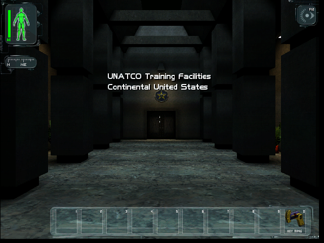
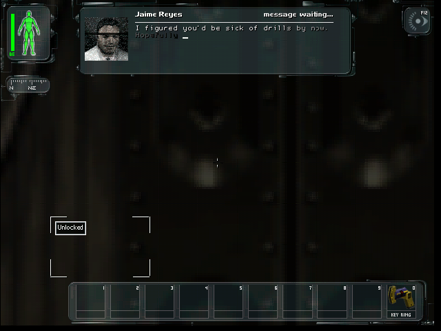

# Deus Ex original Training and movement — PASS (bounded)

On 2026-10-22, the original demo reached its ordinary menu, loaded Training,
displayed the UNATCO world and HUD, and moved the player from the entrance hall
to the first door using normal Up-arrow input. All six original PNG captures
were reviewed directly. One normal attempt was used; no configuration/input
retest was needed. The process completed 4,382 batches in 284.972 wall seconds,
then exited 0 after the control driver's normal quit request. No unimplemented
API or Wasm runtime trap appears in this run's log.

## What the native closure actually requires

The missing native dependency was **MSVCRT**, not every library named by the
loader's generic warning. Its existing local VC6 redistributable fixture is
278,581 bytes, SHA-256
`887eb5ce93edb7192ca3e9220f07f9ca0f94db02af5862ebcbdfcb852db99fd1`.
The pinned provenance is preserved verbatim in `native-provenance.md`. Every
game import from it has a nonzero authentic export; `_vsnwprintf` is present,
with no export forwarder. MSVCRT imports only KERNEL32, and every such imported
name is in the accepted API table. It was streamed in five Boat exec chunks to
`/home/user/deus-ex-training/test/binaries/dlls/msvcrt.dll` and hash-checked.

The complete static imports from the other warned libraries are:

| Library | Imports from the selected game modules | Accepted resolution |
| --- | --- | --- |
| COMCTL32 | ordinal 17 | Existing ordinal mapping to `InitCommonControls`; existing emulator window creation recognizes common-control classes |
| SHELL32 | `ShellExecuteA`, `ShellExecuteW`, `Shell_NotifyIconA` | Existing WAT handlers |
| OLE32 | `CoCreateGuid`, `CoCreateInstance`, `CoInitialize`, `CoUninitialize` | Existing WAT handlers |

`necessary-closure.json` and `existing-emulated-handlers.json` preserve the
checks and exact accepted handler bodies. No handler, stub, resolver policy,
guest state, or API gate was added or changed. These are the accepted runner's
normal emulated system modules. The generic missing-native warnings remain
visible in the raw log; their presence is not concealed or equated with a
missing required native export.

The bounded search also located the pre-existing Explorer98 SHELL32/OLE32
copies and their SHLWAPI dependency. `closure-audit.json`, five independent
`*.objdump.txt` files and `candidate-graph.json` preserve their actual hashes,
imports and exports. The accepted graph resolver finds 14 game DLLs plus five
candidate native support DLLs if all are made available. That unnecessary
native route introduces many unresolved system API imports and does not
establish runtime suitability. The historical OLE32 provenance specifically
does not reconstruct its original archive extraction. Those files were neither
restored nor staged. COMCTL32's VC6 pin was verified, but its native body is
unnecessary for the one ordinal this game imports.

`selected-graph.json` records the actual selected closure: the 14 original game
DLLs plus MSVCRT, with only the three fully enumerated emulated-library warnings.
`stage-native.py` checks these imports, MSVCRT provenance/exports/dependencies,
and both disk guards before transfer. `graph.js` independently replays the
accepted `resolveDllGraph` and `detectRequiredDlls` on the original bytes.
Static API-table membership is not a universal implementation proof: for
example, the original EXE's `FindWindowExW` import remains a static audit gap,
but caused no observed failure here. The successful bounded runtime qualifies this route,
not every possible dynamic import or error path.

## Exact runtime and evidence

- Accepted remote main/source: `c26252c4a95babe583ade1d1c6e2da0c050be45c`.
  Source equivalence to qualified `ce4ce4f95eacaedff1b3e386f3ce3ae5d85bd16c`
  is retained in `prior-source-mapping.json`.
- Reused shipping Wasm SHA-256:
  `f644bbb26edc077239dac17b8b2cfda482aafd9eb44af4c4776d4fe153d5a1a7`.
  Its original qualification archive and receipt are identified in
  `prior-module.json`. There was no rebuild.
- All 192 staged source/support files and all 112 game assets (233,696,463
  bytes) were hash-verified before and after the run. Individual hashes,
  original EXE/Core/Entry pins and registry transformations are in
  `prior-source-manifest.json` and `prior-assets.json`. The original 253,952-byte
  EXE is SHA-256
  `2ed115d9dc93582273830d9ae38f92ab4379842459e24eaec11390f312d5af5f`.
- Same assigned box `bx_2gnkcnac`, Node v24.18.1, unchanged registered
  `deus_ex_demo`, SoftDrv software renderer, cooperative `--no-threads`, frozen
  control, 200,000-block batches, 25 ms guest clock per batch, 1,800-second
  wall limit. `launch.sh` records the exact command. Started 02:17:59 UTC;
  normal quit/exit at 02:22:44 UTC.
- Boat exec only; no SCP retry, download, archive restoration, game repackaging,
  browser deployment, box recreation or lifecycle change.

| Batch | Normal input / observation | Original capture |
| ---: | --- | --- |
| 3000 | Animated original Deus Ex intro | `intro-3000.png` |
| 3200 | Escape, then 200 steps: ordinary main menu | `menu.png` |
| 3224 | Three Down-arrow holds of 4 batches each, with release gaps | `menu-selection.png` |
| 3828 | Enter held 4 batches, released; 600 steps: UNATCO Training world/HUD | `training-before.png` |
| 3982 | Up held from batch 3828 to 3978, released; 4 steps: player at first door, Jaime transmission | `training-after-movement.png` |
| 4382 | Additional 400 batches with movement released: world remains live, transmission advances | `training-settled.png` |

`input-log.jsonl` records complete control requests, responses, timestamps and
Boat command IDs. `run.log` confirms delivery of both Up key events through
the normal input path. The changed hall/door geometry establishes movement;
this is not merely intro animation or a changing overlay. The post-release
400-batch interval is 10 seconds of configured guest-clock advancement and
12.656 seconds between Boat command timestamps, with no trap.

The untouched remote evidence directory is retained as
`native-support-evidence.tar.gz`, 762,377 bytes, SHA-256
`ce1171c629af8e09299ec0fe7764c8ede3cf5ce034d030e530ba61dc8d52272e`.
All six separately retained PNGs and `run.log` were compared byte-for-byte
against this hash-verified archive. `seals.json` covers the task evidence.
Prior failed logs are retained separately under `prior-*`; they were not
replaced or presented as this run's result.

## Handoff and limits

The runner exited 0; no test process or port 8123 listener remains. The same
box is left **RUNNING** (Boat `idle`, health `ok`), with about 48.8 GB free and
staging at `/home/user/deus-ex-training`. Expiry is
`2026-10-22T03:44:34.864Z`; shutdown remains coordinator-owned, checkpoint
03:34 UTC. Ownership is handed back before the requested 03:24 deadline.

Only this task's report/driver/evidence paths are committed. Main is not merged;
root WIP/index/config/TODOS/STATUS were not edited. No workers were spawned and
the held timer-thread lifetime action was not investigated. Local allocation
remains below 64 MiB and admission stayed above 2,982,150,144 free bytes.

This proves original Training startup, visible world/HUD, ordinary movement,
and a short trap-free interval on the specified accepted module. It does not
qualify Windows parity, browser performance, audio quality, long sessions,
the complete Training map or the full game. Independent acceptance remains
coordinator-owned. Task complete; stop.
